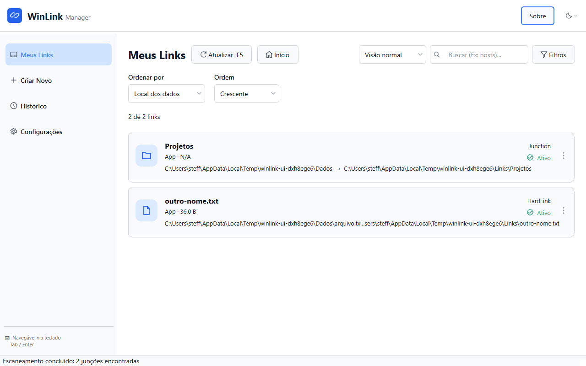

# WinLink



## Em poucas palavras

O WinLink ajuda você a organizar arquivos e pastas no Windows sem precisar digitar comandos. Ele cria ligações para que um arquivo ou pasta possa ser acessado por outro caminho.

Por exemplo: você pode guardar uma pasta de projetos em outro disco e manter uma ligação no endereço antigo. Assim, programas que usam aquele endereço continuam encontrando os arquivos. O WinLink permite localizar essas ligações, criar novas e desfazê-las com prévia e confirmação.

## Baixar e começar

Acesse a [release v0.1.7](https://github.com/steffmartin/win-link/releases/tag/v0.1.7):

- **Instalador:** `WinLink-Setup-0.1.7.exe`, instalação por usuário.
- **Portátil:** extraia todo o `WinLink-Portable-0.1.7.zip` e execute `WinLink/WinLink.exe`. Mantenha a pasta `_internal` ao lado do executável.
- `SHA256SUMS.txt` contém os hashes dos dois pacotes.

Os pacotes incluem Python e as dependências. O aplicativo foi validado localmente em Windows 11 e não possui assinatura digital. Windows 10, Windows limpo sem Python e o sucesso de symlinks com privilégios apropriados não foram homologados; o mantenedor dispensou essas validações para a release inicial.

Escolha as pastas incluídas e excluídas da descoberta em **Configurações**, abra **Meus Links** e use **Criar Novo** para preparar uma operação. Confira os caminhos e avisos antes de confirmar. O [guia de uso](docs/USO.md) explica criação, reversão, histórico e recuperação de falhas.

## Recursos e funcionamento

Aplicativo desktop em Python/PyQt6 para descobrir, criar e desfazer links do sistema de arquivos:

| Tipo | Para que serve | Restrição principal |
|---|---|---|
| Junction | Redireciona uma pasta para outro diretório local | Não usa destino de rede |
| Symlink de diretório | Cria uma ligação simbólica para uma pasta | Depende das permissões do Windows |
| Symlink de arquivo | Cria uma ligação simbólica para um arquivo | Depende das permissões do Windows |
| Hard link | Dá outro nome ao mesmo arquivo | Exige o mesmo volume |

Inclui busca, filtros, ordenação, cartões e visão compacta, propriedades, histórico exportável, temas claro/escuro/sistema e preferências persistentes. Operações têm prévia, confirmação e cancelamento cooperativo. A reversão verifica a identidade do link; diretórios oferecem opções de restauração e backup. Os dados ficam, por padrão, em `%APPDATA%\WinLink`.

Symlinks podem exigir Modo de Desenvolvedor ou execução com privilégios apropriados. O aplicativo não eleva permissões automaticamente. Consulte os avisos de cada operação e confira backups antes de apagá-los.

## Desenvolvimento

Requisitos: Windows, Python 3.12+ e uv. A partir da raiz:

```powershell
uv sync --extra dev --extra build
.venv\Scripts\python.exe -m winlink.main
```

Também é possível abrir com `iniciar-winlink.bat` após instalar as dependências.

```powershell
.venv\Scripts\python.exe -m pytest -q
.venv\Scripts\python.exe -m ruff check src resources
.venv\Scripts\python.exe -m black --check src resources
.venv\Scripts\python.exe -m mypy src
```

## Organização e documentação

| Caminho | Conteúdo |
|---|---|
| `src/winlink/` | Aplicativo: domínio em `core`, interface em `ui`, infraestrutura em `utils` |
| `tests/` | Testes automatizados do aplicativo |
| `resources/` | Ícones e recursos visuais |
| `installer/`, `winlink.spec`, `scripts/` | Fontes e ferramentas de empacotamento e validação |
| `docs/` | Documentação vigente e imagem da tela principal |
| `docs/arquivo/v0.1.0/` | Histórico de desenvolvimento, planos, especificação, protótipo React e evidências |

- [Uso](docs/USO.md): instalar, criar, descobrir e desfazer links.
- [Distribuição](docs/DISTRIBUICAO.md): gerar e validar pacotes.
- [Continuidade](docs/CONTINUIDADE.md): orientações técnicas de manutenção e limites da release.
- [Guia de UI](docs/UI.md): padrões visuais, componentes e interações para continuidade.
- [Orientações para agentes](AGENTS.md): regras obrigatórias e índice de leitura sob demanda.
- [Issues do GitHub](https://github.com/steffmartin/win-link/issues): registro de bugs e melhorias.
- [Notas de versão](docs/NOTAS-DE-VERSAO.md).
- [Arquivo histórico](docs/arquivo/v0.1.0/README.md).

Builds, pacotes, logs, caches, ambientes virtuais e dependências ficam fora do Git. O protótipo arquivado é referência visual e não participa do aplicativo ou de sua distribuição.

Licença [MIT](LICENSE).
