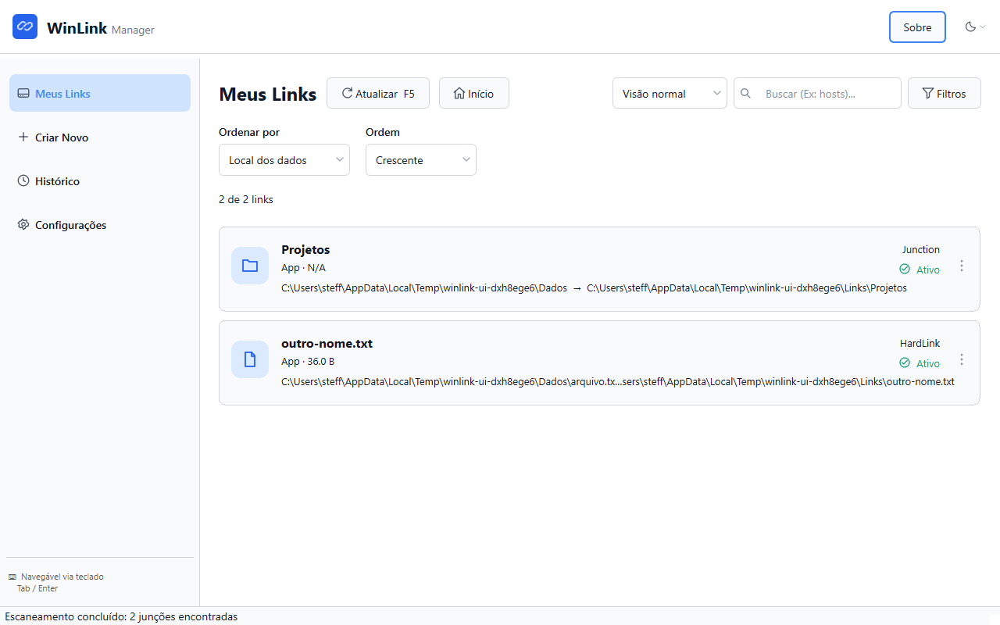

# Guia de continuidade da interface

Referência vigente para evoluir o aplicativo PyQt6 sem ler todo o protótipo React. A implementação atual e seus testes são a fonte executável; este guia resume a direção visual e os comportamentos que devem ser preservados. Propostas nas Issues não são funcionalidades já entregues.

## Estrutura visual e componentes

Cabeçalho com marca, Sobre e escolha de tema; navegação lateral com Meus Links, Criar Novo, Histórico e Configurações; páginas em área central com rolagem própria; status de descoberta no rodapé. Reutilizar os componentes existentes antes de criar novos padrões.

| Responsabilidade | Código relativo a `src/winlink/` |
|---|---|
| Shell, ações, atalhos, navegação e descoberta | `ui/main_window.py` |
| Páginas e componentes responsivos compartilhados | `ui/pages.py`, `ui/components.py` |
| Lista virtualizada/cartões, dados e filtros | `ui/link_cards.py`, `ui/junction_model.py`, `ui/junction_filter.py` |
| Ícones vetoriais, tokens, paleta e estilos | `ui/icons.py`, `ui/theme.py`; recursos em `resources/ui/` na raiz |
| Criação, prévia, propriedades e reversão | `ui/dialogs/create_junction_dialog.py`, `preview_dialog.py`, `properties_dialog.py`, `undo_dialog.py` |
| Progresso e execução fora da thread gráfica | `ui/dialogs/progress_dialog.py`, `ui/operation_worker.py` |
| Histórico e configurações | `ui/dialogs/history_dialog.py`, `ui/history_actions.py`, `ui/dialogs/settings_dialog.py`, `core/config.py`, `core/history.py` |

Domínio e acesso ao disco permanecem em `core/operations.py`, `file_ops.py`, `validators.py`, `process_manager.py`, `scanner.py` e `cache.py`. Workers comunicam resultados por sinais Qt; não bloquear a thread gráfica. Os mecanismos do domínio são JUNCTION, SYMLINK e HARDLINK; a apresentação distingue symlink de arquivo/diretório.

## Aparência

- Fonte do sistema, preferindo Segoe UI no Windows. Referência visual: corpo 14–16 px, títulos 20–24 px em negrito e caminhos em monospace. Respeitar métricas e escala do Qt; não fixar alturas que cortem texto.
- Espaçamentos de referência: 4, 8, 12, 16, 24 e 32 px; margens centrais de 24 px; bordas finas e cantos de 6–12 px. Usar layouts flexíveis e componentes compartilhados.
- Sidebar atual: 256 px em desktop e 192 px abaixo de 1100 px de largura. Reutilizar o comportamento responsivo implementado; não impor largura mínima que force a janela a exceder a tela.
- Criação oferece cartões Pasta/Arquivo seguidos por dois cartões de tipo compatíveis em uma linha, cada um com ajuda no canto superior direito. O tipo padrão pré-seleciona também sua categoria; textos de orientação junto aos caminhos ocupam uma linha e a faixa azul da prévia tem duas linhas específicas para cada tipo. Os cartões da lista mantêm altura fixa; as pills de tags compartilham a linha dos caminhos, alinhadas à direita. Menus de contexto mantêm ícones centralizados na coluna compacta ao lado dos rótulos. Em Configurações, as listas de pastas incluídas e excluídas ficam lado a lado em largura ampla e empilhadas em largura reduzida. Histórico pode rolar sua tabela horizontalmente quando necessário.
- Ícones vetoriais consistentes com `ui/icons.py`, acompanhados de rótulo ou descrição acessível. Não substituir por emojis nem criar outro sistema visual.

Usar `ThemeColors`, `ThemeManager` e os estilos existentes como fonte de cores, sem espalhar novas cores fixas nos widgets:

| Token | Claro | Escuro |
|---|---|---|
| Fundo | `#FFFFFF` | `#111827` |
| Superfície | `#f9fafb` | `#1f2937` |
| Superfície alternativa | `#f3f4f6` | `#374151` |
| Primária | `#2563eb` | `#2563eb` |
| Texto | `#111827` | `#FFFFFF` |
| Texto secundário | `#5C5C5C` | `#D0D0D0` |
| Borda | `#d1d5db` | `#4b5563` |
| Sucesso / aviso / erro | `#107C10` / `#9B8F06` / `#C42B1A` | `#6CCB6F` / `#E2D868` / `#FF8A80` |

Estados normal, hover, foco, seleção e desabilitado precisam continuar legíveis nos dois temas. Cor não pode ser o único indicador de resultado. Seguir sistema deve reagir ao tema do Windows; a troca rápida deve respeitar a preferência persistida e a opção automática.

## Fluxos e estados que devem permanecer

| Área | Contrato de interação |
|---|---|
| Lista | Cartões e visão compacta; busca nos dois caminhos; filtros multisseleção de criador, status, tipo e tags; ordenação crescente/decrescente; distinguir lista vazia de ausência de resultados. Opções marcadas combinam-se por união dentro do campo e por interseção entre campos; todos os valores marcados não restringem a lista e nenhum marcado não retorna resultados. Tags aparecem como pills no cartão e em coluna própria na visão compacta. |
| Descoberta | Atualizar/F5 repete scan. Limpar os critérios de filtro fica na janela **Filtros**; não altera a busca independente nem a ordenação. Excluir uma pasta impede percorrer sua subárvore mesmo quando há outra raiz incluída dentro dela. Ao fechar durante a descoberta, solicitar cancelamento e esperar a thread finalizar com a interface responsiva. Preservar o cache válido do mesmo escopo ao salvar resultados parciais. Indicar quando a lista pode estar desatualizada. |
| Filtros | A janela de Meus Links organiza os grupos em até três colunas, com um dropdown compacto por grupo. As opções marcáveis aparecem ao abrir o dropdown, então a altura do formulário não depende da quantidade de valores. Todos os valores começam marcados; desmarcar opções reduz o conjunto, e desmarcar todas produz uma lista sem resultados. Tags selecionadas combinam-se por união como os outros valores. O filtro de tags inclui “(Vazio)” para links sem tags; essa escolha combina por união com as tags selecionadas e é persistida separadamente dos nomes de tags. Aplicar confirma o rascunho; Cancelar, X ou Escape descartam. Os filtros são persistidos como listas, migrando índices legados; tags que não existam após uma descoberta completa são removidas do filtro. Busca e ordenação continuam combinadas com os filtros. |
| Criação | Selecionar Pasta/Arquivo antes do tipo de link; apresentar somente opções compatíveis, labels explícitos, validações reais, tipo padrão persistente e tags opcionais. Prévia mostra os caminhos completos e o efeito de migração antes de confirmar. |
| Prévia | Quando o cálculo automático de armazenamento está habilitado, informar espaço necessário/disponível, conflitos, aninhamento e processos bloqueadores. Não confirmar enquanto cálculo obrigatório estiver pendente, houver espaço insuficiente ou bloqueios impeditivos. |
| Progresso | Executar em worker; distinguir executando, cancelando/preservando, cancelado, falha, sucesso e sucesso com aviso. Cancelamento é cooperativo: aguardar a preservação antes de liberar nova operação. |
| Propriedades | Caminhos completos em caixas de no máximo duas linhas visíveis, criador, data, estatísticas, edição de tags, indisponível/não calculado/calculando e recalcular. O texto integral continua selecionável. A preferência de cálculo automático não desativa Recalcular. Abrir pasta usa integração nativa; Reverter usa o mesmo fluxo protegido das demais entradas. |
| Reversão | Revalidar identidade; diretórios oferecem remover link, mover de volta ou duplicar, com opção de backup. Arquivos removem somente o nome verificado. Não interpretar inacessível como vazio ou tamanho zero. |
| Histórico | A tabela usa a área antes ocupada pelos filtros. A ação **Filtros** abre uma janela responsiva em até três colunas para operação, período, resultado e ordenação. Operação e resultado seguem as regras de multisseleção: todos marcados não restringe; opções dentro de um grupo combinam por união; grupos diferentes combinam por interseção; nenhuma opção marcada não retorna resultados. Período é uma escolha única entre Todo período (padrão), Hoje, Última semana, Último mês e Último ano; cada período substitui os demais e os mais longos abrangem os mais curtos. **Ordenar por** inclui todas as colunas da tabela; a ordem padrão é Data / Hora decrescente. Aplicar confirma; Cancelar, X ou Escape descartam; **Limpar** restaura o rascunho padrão (incluindo a ordenação) e exige Aplicar. Distinguir operação e tipo de link; marcar criação já desfeita; exportar todos os registros independentemente dos filtros. “Apagar histórico” exige confirmação e não modifica links. |
| Configurações | Salvar persiste; Restaurar padrões prepara rascunho; Descartar recarrega o salvo. A preferência de cálculo automático de armazenamento controla apenas estimativas automáticas, não o Recalcular manual. A preferência de apresentação de Meus Links define o modo salvo para a lista. Manter compatibilidade com preferências antigas e não apagar histórico/log personalizados ao restaurar preferências. |

Durante operações, preservar os bloqueios existentes contra ações conflitantes. Distinguir falha principal de falha apenas ao registrar histórico: uma criação bem-sucedida com erro no registro não deve incentivar repetição. Se a restauração já ocorreu e a limpeza falhou, informar os caminhos restaurado e preservado e orientar conferência, sem sugerir repetir a reversão.

## Linguagem e acessibilidade

Usar português claro e ações com verbos. Usar **Ponto de Acesso** para o caminho do link e **Dados Físicos** para o local dos dados. A criação apresenta Ponto de Acesso primeiro e Dados Físicos depois, sem alterar os parâmetros dos serviços. Exemplo: Dados Físicos em `D:\Dados\Projetos`, Ponto de Acesso em `C:\Links\Projetos`. Na migração, explicar separadamente onde os dados estão antes e onde ficarão depois. Hard links são nomes equivalentes dos mesmos dados, não uma cópia nem um atalho comum.

Mostrar ambos os caminhos completos nas propriedades, prévia e confirmação. Truncar apenas na lista, mantendo acesso ao valor completo. Mostrar caminhos de backup e recuperação; explicar necessidade de permissões sem prometer elevação automática.

Preservar Tab/Shift+Tab, foco visível, labels associados aos campos, nomes acessíveis e Escape nos diálogos. Ao fechar, devolver foco ao controle de origem quando existir. Usar semântica e controles Qt, sem reproduzir atributos ARIA de HTML. Diálogos precisam permitir alcançar o último controle por rolagem e manter botões de confirmação acessíveis.

Atalhos existentes: Ctrl+N criar, Ctrl+H histórico, Ctrl+, configurações, Ctrl+F buscar, F5 atualizar e Ctrl+Q sair. Não registrar atalhos duplicados ao reconstruir páginas ou trocar tema.

## Validação de alterações de UI

1. Executar os quatro checks definidos em [AGENTS.md](../AGENTS.md). Acrescentar regressão de comportamento/layout quando a alteração justificar, especialmente para clipping, foco e recuperação.
2. Conferir as páginas e diálogos afetados nos temas claro/escuro/sistema, janela 1280×800 e janela reduzida 760×400, respeitando a área disponível do monitor.
3. Para mudanças de layout, executar `QT_SCALE_FACTOR=2` em processo novo. Em PowerShell, definir `$env:QT_SCALE_FACTOR = '2'` e executar `.venv\Scripts\python.exe -m pytest -q tests/test_ui_layout.py`; ao concluir, restaurar o valor anterior da variável.
4. Conferir teclado, caminhos longos, ausência de resultados, erros e avisos pertinentes; rolagem deve alcançar os últimos controles sem comprimir ou cortar os filhos. Para filtros, verificar seleções múltiplas, persistência/migração, tags indisponíveis, aplicar/cancelar/limpar e abertura tanto na lista como no histórico. Reutilizar `tests/test_ui_layout.py`, `test_ui_main_window.py`, `test_ui_theme.py` e testes de workers/falhas conforme o caso.
5. Capturar o aplicativo real com `.venv\Scripts\python.exe scripts/capture_ui.py` quando precisar de evidência visual. Saída padrão em `build/ui-review`, ignorada pelo Git; não sobrescrever o arquivo histórico. Atualizar a imagem do README somente se a mudança tornar a captura vigente obsoleta.

Use este guia e a implementação PyQt6 em `src/winlink/ui/` como referência. Não introduzir fixtures, temporizadores ou integrações fictícias de protótipos na aplicação.
