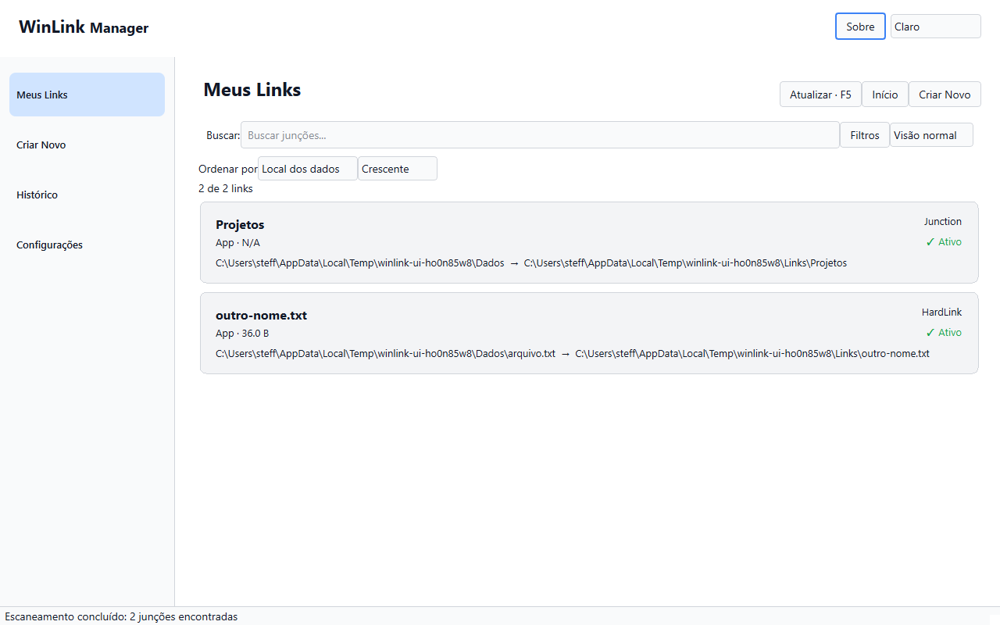
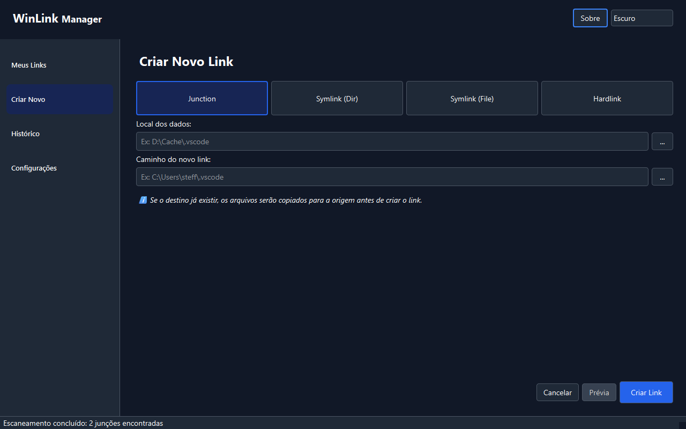
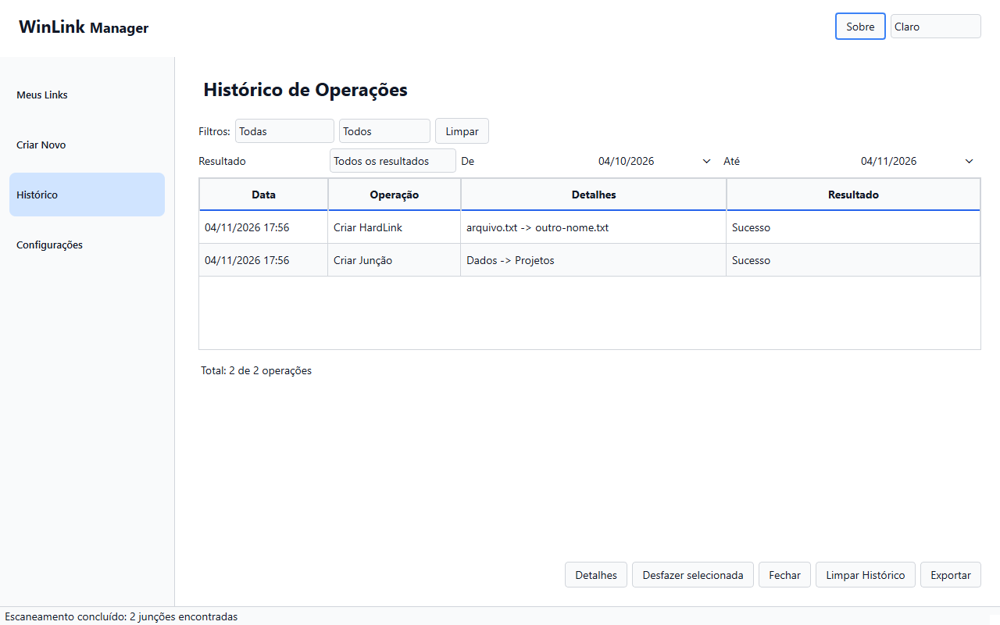
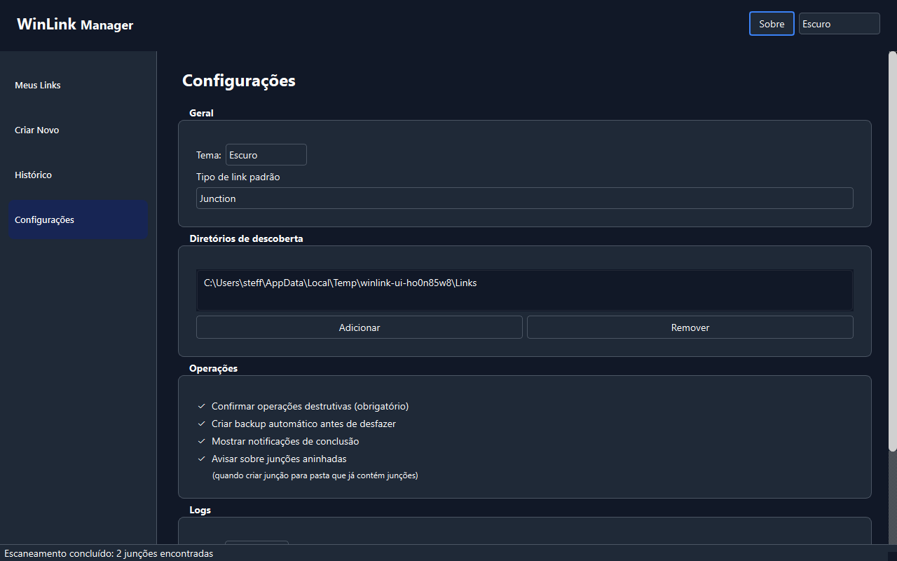
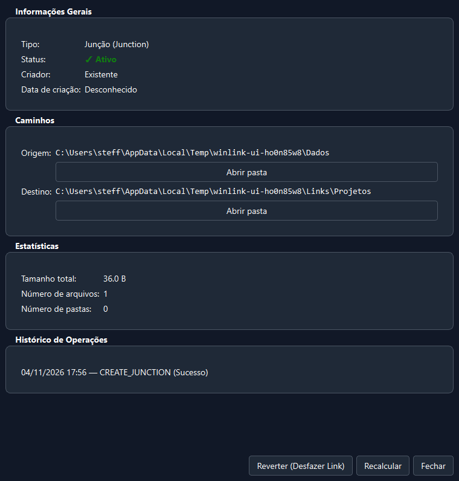

# Guia de uso do WinLink 0.1.0

## Instalar e abrir

O instalador offline é `dist/WinLink-Setup-0.1.0.exe`. A versão portátil exige toda a pasta `dist/WinLink`, incluindo `_internal`. Não precisa de Python instalado para executar o pacote; a homologação em outro Windows sem Python ainda está pendente. O aplicativo é por usuário e não solicita elevação automática. Código sob licença MIT; pacote sem assinatura digital.

## Encontrar links

Em **Configurações**, escolha pelo menos um diretório absoluto para descoberta e salve. **Meus Links** abre a lista em cartões; **Compacta** apresenta a tabela. A busca procura nos dois caminhos. **Filtros** combina criador, status e tipo, distinguindo symlinks de arquivo/diretório. Aplicar confirma o rascunho; Cancelar/Escape o descarta. Ordenação inclui caminhos, criador, tipo, tamanho e status. Tamanho indisponível não significa pasta vazia. Clique duas vezes ou use Enter para propriedades; o menu de contexto também permite desfazer.

O cache acelera a abertura e uma varredura nova atualiza a lista. **Atualizar/F5** repete a descoberta; **Início** limpa busca/filtros e atualiza. Se a atualização falhar, confira o aviso e os diretórios, depois tente novamente. Uma lista preservada pode estar desatualizada; cada reversão verifica novamente o link.

## Criar

Em **Criar Novo**, escolha Junction, Symlink (Dir), Symlink (File) ou Hardlink. **Local dos dados** é onde os dados ficam; **Caminho do novo link** é o nome que aponta para eles. A preferência de tipo padrão vale para um formulário vazio.

Diretórios podem usar um novo local dos dados. Se o caminho do link já contiver uma pasta normal, a prévia explica a migração. Arquivos exigem dados existentes e um novo nome livre; hard links exigem o mesmo volume. Symlinks podem exigir Modo de Desenvolvedor ou privilégios apropriados. Nenhuma opção faz elevação automática.

Revise caminhos completos, espaço, processos e avisos na **Prévia**. A confirmação é obrigatória. Feche manualmente processos informados e recalcule a prévia. Operações são executadas em background. **Cancelar** solicita interrupção cooperativa; aguarde a preservação dos dados antes de fechar.

## Propriedades e reversão

Propriedades mostra caminhos, criador, data, estatísticas e histórico relacionado. **Recalcular** atualiza as estatísticas; **Abrir pasta** usa o Explorer. **Reverter** abre o mesmo fluxo protegido do menu e histórico.

Para diretórios, escolha remover só o link (deixa pasta vazia), mover de volta ou duplicar. **Manter origem como backup** preserva o local dos dados. Arquivos removem somente o nome selecionado após verificar a identidade; os demais nomes e dados permanecem. Um caminho inacessível não dispensa a verificação de identidade.

Em falhas, leia os caminhos preservados antes de agir. Se os arquivos já foram restaurados e a limpeza falhou, **não repita a reversão**: confira a pasta restaurada e a origem preservada. Sucesso com backup informa o caminho a conferir. Falha apenas no histórico não desfaz a operação: confira o link antes de repetir. Nunca apague um backup sem verificar os dados.

## Histórico e preferências

O histórico combina operação, resultado, períodos rápidos e datas inclusivas em **Personalizado**. **Detalhes** mostra caminhos, erro e metadados. Criações já desfeitas são indicadas e não podem ser revertidas novamente pelo histórico. Registros novos guardam identidade; registros antigos continuam legíveis e usam a verificação de integridade existente. **Exportar** inclui todos os registros, independentemente dos filtros. **Limpar Histórico** exige confirmação e não altera links.

O cabeçalho permite Claro, Escuro e Seguir sistema; automático acompanha mudanças do host. Nas configurações, **Restaurar padrões** prepara os campos e só persiste com **Salvar**. **Descartar alterações** recarrega os valores salvos. Caminhos personalizados do histórico/log não são apagados pela restauração de preferências. Notificações, backup, avisos e nível de log usam os serviços reais. **Abrir pasta de logs** ajuda a investigar falhas.

Atalhos: Ctrl+N criar; Ctrl+H histórico; Ctrl+, configurações; Ctrl+F buscar; F5 atualizar; Ctrl+Q sair. Tab/Shift+Tab percorrem controles; Escape fecha confirmações ou solicita cancelamento seguro no progresso. Telas e diálogos têm rolagem para alcançar os últimos controles em janelas pequenas.

## Desinstalar e limites

O desinstalador remove configuração/cache/log padrão e pergunta se deve manter o histórico. Em modo silencioso mantém o histórico, salvo `/DELETEHISTORY`. Não apaga dados migrados, destinos de junctions nem arquivos de histórico/log personalizados.

Windows 10 mínimo e máquina limpa sem Python ainda precisam de homologação. Neste host a criação de symlinks retornou erro 1314; o teste comprova a falha segura, não o sucesso com privilégios. Ver [validação](../validacao/REDESIGN.md).

## Capturas do aplicativo real

Geradas com links reais em diretório temporário isolado, sem dados do usuário.

